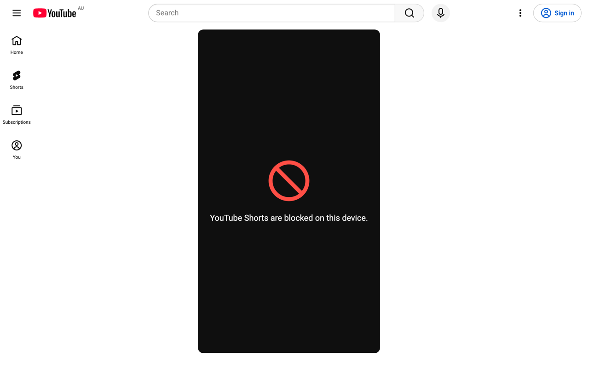

# Shorts Block

A minimal Manifest V3 Chrome extension for schools. Every YouTube Short is replaced with a plain block screen, the comments and description panels are hidden, the surrounding recommended Shorts are hidden, and scrolling or arrowing to the next Short is disabled. The rest of YouTube is untouched.



It is a handful of small files with no background worker, no options page and no network access. Its only permission is `storage`, used to read the settings an administrator sets by policy. Apart from a few CSS rules for Shorts shelves, it does nothing until a Shorts page is actually open, which keeps it cheap enough for low-end Chromebooks.

## Files

| File | Purpose |
| --- | --- |
| `manifest.json` | Declares one content script for `https://www.youtube.com/*` and `https://m.youtube.com/*`, and the policy schema. |
| `managed_schema.json` | The settings an administrator can set by managed policy. |
| `content.js` | Reads the policy, decides when the block applies, keeps the video paused, swallows scroll and navigation keys, and redirects when asked to. |
| `block.css` | Hides the player, overlay, panels and arrows, draws the block screen with pseudo-elements, and hides Shorts shelves. |
| `icons/` | Extension icons at 16, 32, 48 and 128 px, rendered from `icon.svg`. |
| `store/` | Web Store listing screenshot (1280 x 800 PNG). |
| `PRIVACY.md` | Privacy policy: nothing is collected, stored or transmitted. |
| `maintain/` | Live-site test and repair harness (not part of the extension). See `maintain/README.md`. |

## How it works

YouTube is a single-page app, so the URL changes without a page load. The content script runs at `document_start` and listens for YouTube's own navigation events: `yt-navigate-start` and `yt-navigate-finish` on the desktop site, `state-change` and `state-navigateend` on the mobile site, with a one-attribute observer on the mobile `<body>` class as a safety net. When the page is a Short it adds `class="ytsb-blocked"` to `<html>`; otherwise it removes it. Everything visual is a CSS rule under that class, so toggling one class is the whole cost of blocking or unblocking.

- **Block screen:** the player box (`#player-container` on desktop, `<shorts-video>` on mobile) keeps its size while its children are hidden, so the block icon and message are drawn on it with `::before` and `::after`. No DOM is inserted and nothing in the page tree is observed.
- **Sound:** CSS cannot stop audio. A single capture-phase `play` listener on `document` pauses any media element that starts while a Short is blocked. YouTube reuses one player across Shorts, so this covers every Short the student lands on.
- **Scrolling:** YouTube moves between Shorts on wheel, touch and the arrow and page keys. Capture-phase listeners on `window` stop those events before YouTube sees them. They are attached only while a Short is blocked, because a non-passive wheel listener forces every scroll on the site through the main thread. Keys are ignored when the focus is in a text field, so the search box still works.
- **Comments and recommendations:** the side panels (`#shorts-panel-container`), the overlay with title, channel, like and comment buttons, the previous and next arrows and the thumbnails of neighbouring Shorts are hidden. On mobile the same goes for the comments bottom sheet and the poster frames on the neighbouring carousel slides.
- **Shorts shelves:** while `hide_shorts_in_feeds` is on, `class="ytsb-hide-feeds"` on `<html>` hides the Shorts shelves on the home page, in search results and in a watch page's related videos, the Shorts entry in the desktop sidebar, the Shorts tab in the mobile bottom bar, and the Shorts tab on channel pages. The class is set at `document_start` before the policy is read, so shelves never flash up. The mobile app marks nothing as its home page, so the script also sets `class="ytsb-home"` on `/`.
- **Redirect:** when the `redirect` policy is on, opening a Short sends the student to `redirect_url` instead of showing the block screen. A Short opened directly replaces its own history entry, so Back does not bounce straight into the redirect again. A Short clicked from another page keeps that page in history.

Students can still leave the page through the sidebar, the search box or the browser's back button; the aim is to make Shorts useless, not to trap the tab.

## Settings

Every setting comes from managed policy only; students have nothing to change. With no policy the extension shows the block screen and hides Shorts shelves.

| Policy | Type | Default | Effect |
| --- | --- | --- | --- |
| `redirect` | boolean | `false` | Send students to `redirect_url` instead of showing the block screen. |
| `redirect_url` | string | `https://youtube.com` | Where the redirect goes. Only `http` and `https` addresses are accepted, and never a Short; anything else falls back to the default. |
| `hide_shorts_in_feeds` | boolean | `true` | Hide Shorts shelves on the home page, in search results and in a watch page's related videos, the Shorts entry in the desktop sidebar, the Shorts tab in the mobile bottom bar, and the Shorts tab on channel pages. |

In Google Admin, open the extension under Devices, Chrome, Apps and extensions, and paste the settings into **Policy for extensions**:

```json
{
  "redirect": { "Value": true },
  "redirect_url": { "Value": "https://www.youtube.com/" },
  "hide_shorts_in_feeds": { "Value": true }
}
```

Leave out any setting to keep its default. Chrome shows the values it has received at `chrome://policy`, under the extension's ID. Policy changes take effect on open YouTube tabs without a reload.

**Tip:** If you would rather not depend on YouTube's page markup, turn on `redirect`. Blocking relies on CSS selectors that YouTube may change; when that happens the Short stays paused, but its title, comments or first frame may become visible. A redirect only needs to recognise the Shorts address, so it keeps working through markup changes. The trade-off is that students are sent away without the "Shorts are blocked" message.

## Installing

For a quick trial, open `chrome://extensions`, turn on Developer mode, choose **Load unpacked** and select this folder.

For a managed fleet, deploy it through Google Admin (Devices, Chrome, Apps and extensions, Users and browsers) as a force-installed extension. Google Admin needs either a Chrome Web Store listing or a self-hosted packed `.crx` with an update URL. Publishing to the Web Store needs the icons and screenshot in this repository plus a short privacy declaration (zip the extension files and `icons/` only, leaving out `maintain/`); this extension collects nothing, so the declaration is simple. Students on managed devices cannot disable a force-installed extension.

## Limitations

- Both `www.youtube.com` and `m.youtube.com` are covered. Other hosts such as `youtube-nocookie.com` embeds are not.
- Shorts embedded on other sites are untouched. Shorts shelves are hidden on the home page, in search results and in a watch page's related videos. A channel's home tab may still show one.
- The channel Shorts tab and the full-width sidebar's Shorts entry are matched by their English labels, so a non-English interface still shows them. The narrow icon sidebar and the mobile bottom bar are matched in a language-neutral way. The Shorts filter chip on desktop search results has no hook other than its visible text, so it is left alone; opening a Short from it still hits the block screen or redirect.
- YouTube changes its markup from time to time. The selectors in `block.css` were last checked against the live site on 11 November 2026. The Shorts shelf selectors are the most likely to break; if they do, shelves simply reappear. If a block-screen selector breaks, the video is still paused by `content.js`, but the block screen or an overlay element may need a selector update.

## Keeping up with YouTube

`node maintain/cli.mjs check` tests the extension against the live site in the latest stable Chrome, on desktop and mobile, and explains anything that broke: renamed elements with a verified replacement selector, newly visible elements with a safe selector to hide them, and changed navigation events or Shorts addresses. `fix auto` applies the verified fixes and re-tests, and `finish` bumps the version and commits once everything passes. Details are in `maintain/README.md`.

## Checking it works

Open any Short on either site. You should see a dark panel with a red block icon and the message, no video, no comments, no arrows, and the mouse wheel, swipes and arrow keys should do nothing. Open the Home page or a search: there should be no Shorts shelves, and everything else should behave as usual.
